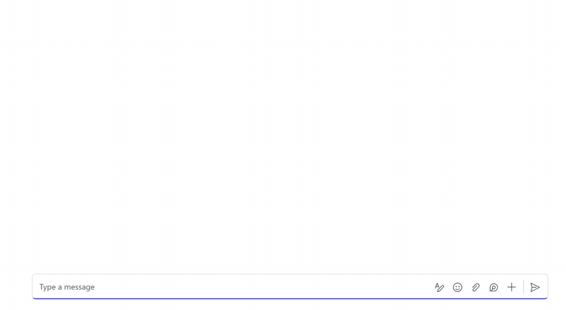

# Iris: an incident agent built as an agentic user, with Teams SDK and Work IQ

A sample Microsoft Teams agent built on the [Teams SDK for .NET](https://microsoft.github.io/teams-sdk/) and
[Microsoft Entra Agent ID](https://learn.microsoft.com/entra/agent-id/agent-users). "Iris" is an **agentic user**, not
a bot:
- **Who:** she has her own Entra account, with a name, photo, manager, mailbox, OneDrive, calendar and Teams licence.
  People message her in a 1:1, add her to group chats, and add her to teams, the same way they would a colleague.
- **How she reads data:** everything she reads in Microsoft 365 goes through
  [Work IQ](https://learn.microsoft.com/microsoft-365-copilot/extensibility/) **as Iris**, with her own agentic user
  token. She sees only what she's a member of or what has been shared with her.
- **What she does with it:** incident summaries, runbook answers and shiproom updates, written by an Azure OpenAI
  or OpenAI model. She can also act on her own when a conversation calls for it, without being @mentioned.

Everything tenant-specific is a setting: the agent's identity and profile, the model, the Work IQ endpoint, the
runbook, the meeting it prepares for, and the Teams features it uses. See [Make it your own](#make-it-your-own) to
build a different agent on the same pattern.

[docs/SCENARIO.md](docs/SCENARIO.md) walks through an incident with Iris and a colleague in your own tenant. It has
the main incident scenario and a second one for the Teams features for agent users: streaming with progress steps,
notifications, cards in notifications, a card dialog, and a channel thread.



## What Iris does

| Where | What people do | What Iris does |
| --- | --- | --- |
| 1:1 chat | Ask a question, e.g. "what does our runbook say about AADSTS7000215?" | Reads the runbook (a markdown file in **her own OneDrive**), picks the matching cases and answers with the steps |
| 1:1 chat | "Are you on the invite for tomorrow's shiproom?" | Looks the meeting up on **her own calendar** and gives its time, organizer and attendees |
| Group chat | Add Iris with chat history | Introduces herself |
| Group chat or channel thread | "@Iris catch us up" | Reads the conversation and posts an incident summary: impact, cause, fix, next steps with owners, matching runbook cases |
| Group chat or channel thread, **no @mention** | Two people agree "we'll need an update for tomorrow's shiproom" | Works out what's needed and does it: finds the meeting on her calendar, opens last week's deck from the invite, copies the incident slide's layout, and drafts the update with what changed since her summary |
| Same, no @mention | "Looks good, can you add it to the deck?" | Marks the draft approved and posts the slide text ready to paste into this week's deck, with a link to the deck ([Work IQ notes](docs/WORKIQ-NOTES.md#reading-a-deck)) |
| Channel thread | "@Iris post the current status here" | Posts a status update that carries what she learned in other conversations, such as a new severity |
| Team | Add Iris as a member | Introduces herself in General |

Iris has no commands. A model classifies each request (summarize, shiproom update, approve the draft, or answer) and
she acts on it.

She also uses Teams message features as an agent user rather than a bot: streamed answers with progress steps,
runbook citations, feedback buttons, a sensitivity label, reactions when she picks up and finishes a request, the
shiproom draft as a card with Approve, Edit and Discard, a like on the card to approve it, and a status widget
under summaries. [docs/FEATURES.md](docs/FEATURES.md) covers each one, with its setting and notes for building your
own agent. Preview features are off by default.

## How it works

```
 Teams (1:1, group chat, channel) ──► POST /api/messages  (IncidentAgent, ASP.NET Core + Teams SDK)
   delivery set on the agent blueprint:   │  1. drop repeats (same activity ID), keep only Teams traffic for an agent user
   endpoint = Developer Portal URL;       │  2. group/channel without an @mention: "read along" (see below)
   mode = @mentions only (default)        │  3. typing indicator, then queue the work; Teams gets 200 at once
         or all messages                  ▼
                                    WorkQueue (background, max 8 at once, 5-minute timeout)
                                          │ Teams SDK: agentic user token for Work IQ
                                          │ (blueprint, then agent identity, then agent user; nobody signs in)
              ┌───────────────────────────┼──────────────────────────────────────┐
              ▼                           ▼                                      ▼
   Work IQ MCP, as Iris:         Azure OpenAI (IChatClient):              Teams SDK, as Iris:
   chat / channel messages,      classify intent, summarize,              proactive SendAsync with her
   her calendar, her OneDrive    draft the shiproom update; tools:        AgenticIdentity, so every post
   runbook, decks via invite     get_runbook_cases, find_meeting          comes from her account with the
   links                                                                  "AI agent" badge
              └───────────────────────────┼──────────────────────────────────────┘
                                          ▼
                       Read along: after Iris posts in a group chat or channel thread, she keeps
                       reading it for 10 minutes. Settled exchanges go to the model; she acts only
                       on a shiproom update, summary or draft approval at confidence ≥ 0.7.
```

**Agentic user vs a traditional bot:**

| | Traditional bot | Agentic user (this sample) |
| --- | --- | --- |
| Identity | An Entra app plus an Azure Bot resource | An agent blueprint (Entra app), an agent identity, and an **agent user**: a real directory account |
| How people add it | Install a Teams app package in each chat or team | Add Iris like a person; no app package or Teams app install |
| Messaging endpoint | Azure Bot messaging endpoint | Notification URL on the blueprint (Teams Developer Portal, or the Graph `communicationConfiguration` API) |
| Whose data | The signed-in user's, through SSO and On-Behalf-Of. Needs a sign-in per user. | Iris's own: her chats, calendar, OneDrive, and what's shared with her. No user sign-in. |
| Unmentioned messages | Needs RSC (`ChatMessage.Read.Chat`) and owner consent at install | @mentions only by default. The blueprint can switch to all messages ([MESSAGE-DELIVERY.md](docs/MESSAGE-DELIVERY.md)). |
| Licences | None for the bot | A Teams licence (plus Exchange/OneDrive for mail, calendar and files) for the agent user |

**Design choices:**
- **Everything in Microsoft 365 goes through Work IQ as Iris.** Iris has one delegated grant (`WorkIQAgent.Ask`
  for her agent user) and no Graph application permissions. Admins govern Work IQ centrally in the Microsoft 365
  admin center. Iris can read only what a colleague in her position could.
- **Proactive, but cautious.** In a group chat or channel thread, Iris reads along only after she has posted
  there, for `Watch:WindowMinutes`. She waits for the exchange to settle, then acts only on a few kinds of request,
  above a confidence threshold. When unsure, she stays quiet.
- **Memory across conversations.** Incident notes are kept per incident ID. So a status update in a channel carries
  facts learned in the group chat, such as "now Sev 3". This memory is in process only (see
  [Production notes](#production-notes)).
- **The deck template comes from the team's own deck.** Iris finds the decks through the links in the meeting
  invite: a linked file is this week's deck, and a linked folder holds earlier ones. She copies the layout of the
  `Shiproom:SlideTitle` slide, never its facts. When the team approves the draft, she posts it ready to paste into
  this week's deck.
- **Untrusted content is fenced.** Messages and files go to the model as quoted data, and the prompts say never to
  follow instructions found in them.

### How Work IQ is used

This sample calls Work IQ's `fetch` and `fetch_blob` tools with paths such as `/chats/{id}/messages`,
`/me/calendarView` and `/drives/{id}/items/{id}/content`. These paths are hard-coded in `WorkIqPaths` for now. The
recommended approach is to discover them at run time with Work IQ's `search_paths` and `get_schema` tools.

The model never sees Work IQ's own tools. It only gets two tools the app defines: `get_runbook_cases`, which is local,
and `find_meeting`, which wraps a calendar read.

For application code, the Work IQ client also exposes `DownloadFileAsync` and `UploadFileAsync`. MCP prepares a
transfer; a separate HTTP client attaches the agent user's Work IQ token and streams bytes directly between Work IQ
and absolute local file paths, without base64 payloads, whole-file buffering, or model context. These optional APIs
are not model tools and do not change Iris's runbook or deck workflows. See
[file transfers](docs/WORKIQ-NOTES.md#file-transfers-without-model-context) for usage and service prerequisites.

What Work IQ adds here is:
- **The identity and permission model:** one delegated scope for the agent user, and reach limited to what's shared
  with her.
- **Central admin control and metering:** on/off, data areas and write actions in the Microsoft 365 admin center,
  billed in Copilot Credits.

The sample doesn't use:
- **Model-driven discovery** (`search_paths`, `get_schema`), where the model works out which data to read at run time.
- **Grounded answers** (`ask`, `retrieve`) over the semantic index.

They'd be the next step if you want the model to reach data the code doesn't anticipate. Details are in [docs/WORKIQ-NOTES.md](docs/WORKIQ-NOTES.md).

## Project layout

```
AgenticUserWorkIq.slnx
src/IncidentAgent.Core/      Teams-agnostic logic (unit tested)
  Agent/                     IncidentAgentService (direct + observed turns), AgentMemory, Messages, WatchLogic,
                             SeenActivities (drops repeat deliveries), DateResolver, options and models
  Conversations/             ConversationLocator (Teams IDs to Work IQ paths), ConversationReader, ChatMessageParser
  Shiproom/                  CalendarReader, DeckFinder (invite links), DeckReader (.pptx)
  Knowledge/                 KnowledgeBase (parses and ranks the runbook), RunbookStore (reads it from OneDrive),
                             RunbookCitations (turns case IDs in a reply into citations)
  WorkIq/                    Work IQ MCP client, authenticated HTTP file streaming, paths, error mapping
  Llm/                       Prompts and model options (Azure OpenAI or OpenAI)
src/IncidentAgent/           ASP.NET Core host
  Program.cs                 Teams SDK + /health
  Teams/                     AgentHandlers (routing, mention check, welcome, card actions, dialogs, reactions,
                             feedback), TeamsSender (proactive posts as Iris), AgentStream (streamed replies),
                             DraftCards, IncidentWidget, TeamsTurn, WatchService (read along), AgentTokens (agentic
                             user token for Work IQ), WorkQueue, TeamsFeatureOptions
  Hosting/                   Dependency injection, chat model client
tests/IncidentAgent.Tests/   xUnit tests, with .pptx fixtures
agent-files/                 The runbook that goes into Iris's OneDrive (100 cases, TB-001 to TB-100)
scripts/                     Python scripts that create the agent identity and put the runbook in its OneDrive
docs/                        SETUP, SCENARIO, FEATURES, MESSAGE-DELIVERY, WORKIQ-NOTES
```

## Getting started

1. Create the blueprint, agent identity and agent user, set the notification URL, and upload the runbook:
   **[docs/SETUP.md](docs/SETUP.md)**.
2. Store the settings in user secrets:
   ```powershell
   cd src/IncidentAgent
   dotnet user-secrets set "AzureAd:TenantId" "<tenant id>"
   dotnet user-secrets set "AzureAd:ClientId" "<blueprint app id>"
   dotnet user-secrets set "AzureAd:ClientCredentials:0:ClientSecret" "<blueprint secret>"
   dotnet user-secrets set "AzureOpenAI:Endpoint" "https://<resource>.openai.azure.com/"
   dotnet user-secrets set "AzureOpenAI:Deployment" "<deployment>"
   ```
   To use OpenAI instead of Azure OpenAI, set `AzureOpenAI:Provider` to `OpenAI`, `AzureOpenAI:ApiKey` to your key
   and `AzureOpenAI:Deployment` to the model name, and leave `AzureOpenAI:Endpoint` empty (or set it to any
   OpenAI-compatible base URL).
3. Run `dotnet run --project src/IncidentAgent` (port 3980) behind a dev tunnel, or deploy it to App Service.
4. In Teams, message Iris in a 1:1 chat, or add her to a group chat or team.

Build and test:

```powershell
dotnet build AgenticUserWorkIq.slnx
dotnet test AgenticUserWorkIq.slnx
```

## Configuration

Settings live in `src/IncidentAgent/appsettings.json`. Override any of them with user secrets locally, App Service
settings or environment variables in Azure (`AzureOpenAI__Deployment`), or the command line
(`--AzureOpenAI:Deployment=...`). Keep secrets out of the file.

User secrets are per machine and shared by every checkout of this sample, because they're keyed by the
`UserSecretsId` in `IncidentAgent.csproj`. To run a second copy with other settings, pass them as environment
variables (for example `$env:AzureAd__ClientId`) or `--AzureAd:ClientId=...` arguments. Both override user secrets.

| Section | Key | Default | Notes |
| --- | --- | --- | --- |
| `AzureAd` | `TenantId`, `ClientId`, `ClientCredentials` | empty (required) | The **agent blueprint**'s app ID and credential. The Teams SDK validates incoming requests and gets agentic user tokens with it. |
| `WorkIq` | `Endpoint`, `Scope`, `TimeoutSeconds` | Work IQ MCP, `api://workiq.svc.cloud.microsoft/.default`, `45` | |
| | `FileTransferTimeoutSeconds` | `240` | Positive per-request timeout for file content/status HTTP, including body streaming; separate from the MCP timeout |
| `AzureOpenAI` | `Provider` | `AzureOpenAI` | `AzureOpenAI`, or `OpenAI` for OpenAI or any OpenAI-compatible server |
| | `Endpoint` | empty | Required for Azure OpenAI. For OpenAI, leave empty for `https://api.openai.com/v1/` or set another base URL. |
| | `Deployment` | empty (required) | The Azure deployment name, or the OpenAI model name |
| | `ApiKey` | empty | Required for OpenAI. For Azure OpenAI, Entra ID is used when it's empty. |
| | `ManagedIdentityClientId`, `TokenScope` | empty, `https://cognitiveservices.azure.com/.default` | Entra ID sign-in for Azure OpenAI: a user-assigned identity, and the token scope |
| | `Temperature`, `MaxOutputTokens` | unset, `2000` | Leave `Temperature` unset for reasoning models |
| `Agent` | `Name` | `Iris` | What the agent calls itself |
| | `Role` | `the helpdesk engineering team's incident agent` | Who the agent is to the team, used in every prompt as "You are {Name}, {Role}." |
| | `DefaultTimeZone` | `America/Los_Angeles` | For "today" and "tomorrow" when Teams doesn't send a time zone (read-along turns never have one) |
| | `GreetWhenAdded` | `true` | Welcome message when added to a group chat or team |
| `Watch` | `Enabled` | `true` | Read along after posting; `false` means @mentions only |
| | `WindowMinutes`, `SettleSeconds` | `10`, `5` | How long to keep reading, and how quiet the chat must be before reading an exchange |
| | `PollSeconds`, `MessagesPerPoll` | `10`, `10` | Polling, used when `ReceivesAllMessages` is `false`. Each poll is one Work IQ call. |
| | `MinConfidence` | `0.7` | Act on unmentioned messages only above this |
| | `ReceivesAllMessages` | `false` | Set to `true` **only** when the blueprint delivers all messages. Iris then reads when Teams delivers a message instead of polling. [MESSAGE-DELIVERY.md](docs/MESSAGE-DELIVERY.md) |
| `Runbook` | `Path`, `CacheMinutes`, `MaxCatalog` | `/Runbooks/helpdesk-bot-runbook.md`, `30`, `40` | The runbook's path in Iris's OneDrive |
| `Shiproom` | `MeetingKeyword`, `LookAheadDays`, `SlideTitle` | `shiproom`, `7`, `Incident updates` | How Iris finds the meeting and the slide |
| `Conversation` | `GroupChatHours`, `GroupChatMinimumMessages`, `MaxMessages` | `24`, `25`, `300` | How much of a group chat a summary reads |
| `WorkQueue` | `MaxConcurrency`, `TimeoutSeconds` | `8`, `300` | |
| `Features` | `Streaming`, `DraftCard`, `ReactionAck`, `SensitivityLabel`, `HtmlWidget`, `WidgetDomain`, `TargetedMessages` | `Personal`, `true`, `true`, empty, `false`, empty, `false` | Which Teams features Iris uses. See [FEATURES.md](docs/FEATURES.md#settings) |

## Make it your own

To build a different agent on this pattern, change these. None of them need code changes.

**The agent's identity.** `scripts/create_au.py` creates the blueprint, agent identity and agent user. Its options
set every name and profile field:

```powershell
python create_au.py --domain contoso.com `
  --blueprint-name "Payments Teammate Blueprint" --identity-name "Sam Payments Agent" `
  --au-name "Sam (Payments Agent)" --au-nick sam.agent `
  --job-title "On-call Agent" --department "Payments" --office "Remote" `
  --manager-upn lead@contoso.com --license-sku <sku-id> --avatar .\sam.png
```

The host has no agent identity or agent user IDs in its settings. Teams sends them with each message, and the Teams
SDK gets the agent user's token through the blueprint in `AzureAd`. So one host serves any agent identity made from
that blueprint. `AzureAd` uses the Microsoft.Identity.Web format, so `ClientCredentials` can name a certificate instead
of a secret. The setup scripts create a client secret.

**The model.** Azure OpenAI with Entra ID, Azure OpenAI with a key, OpenAI, or any OpenAI-compatible server. See the
`AzureOpenAI` rows above.

**The persona.** `Agent:Name` and `Agent:Role` go into every prompt. Set `Agent:DefaultTimeZone` to the team's zone.

**The knowledge.** Put your own runbook in the agent user's OneDrive and set `Runbook:Path`. Keep the layout of
[agent-files/helpdesk-bot-runbook.md](agent-files/helpdesk-bot-runbook.md): `## Category` headings, then one
`### <ID>: <title>` block per case (an ID like `TB-001`) with `**Symptoms:**`, `**Keywords:**`, `**Cause:**` and
`**Fix:**` lines. The agent reads it through Work IQ, as itself.

**The meeting.** `Shiproom:MeetingKeyword` is the word in the meeting subject to look for, and `Shiproom:SlideTitle`
is the slide in last week's deck to copy the layout from.

**The Teams features.** The `Features` switches. See [FEATURES.md](docs/FEATURES.md#settings).

**The behavior.** For new kinds of work, change the code: the intents and instructions are in
`src/IncidentAgent.Core/Llm/Prompts.cs`, and `IncidentAgentService` acts on them.

## Production notes

- **Preview platform.** Agent users, agent blueprints and the Graph `communicationConfiguration` API are in preview
  (Frontier / Agent 365), and some calls are Graph beta. Expect changes.
- **One instance.** Incident notes, drafts, read-along state and the duplicate-delivery filter are in memory. A
  restart forgets them. To scale out, move them to a shared store.
- **Reading along costs Work IQ calls.** With @mention-only delivery, each active conversation is polled every
  `PollSeconds`: up to 60 calls in a 10-minute window. All-message delivery removes the polling, but every message is
  then sent to the agent.
- **Tell people Iris reads along.** Say in her welcome or in team guidance that she reads unmentioned messages for a
  while after she posts. With all-message delivery, also follow the
  [guidance for admins](docs/MESSAGE-DELIVERY.md#guidance-for-admins).
- **Make the welcome idempotent.** Teams can send "member added" again for a conversation Iris is already in, for
  example after her account is re-enabled. The sample greets each time. A production agent can remember where it has
  already greeted.
- **Build each Teams feature as an extra.** Keep runbook case IDs in the text next to their citations, treat
  suggested actions as shortcuts for something people can also type, and send the status widget with the current
  status so it's complete without Refresh. Details are in [FEATURES.md](docs/FEATURES.md).
- **Shared and private channels, and other tenants.** The sample is written for group chats, standard channels and
  one tenant. Check how Iris reads and posts in other kinds of conversation before you rely on them.
